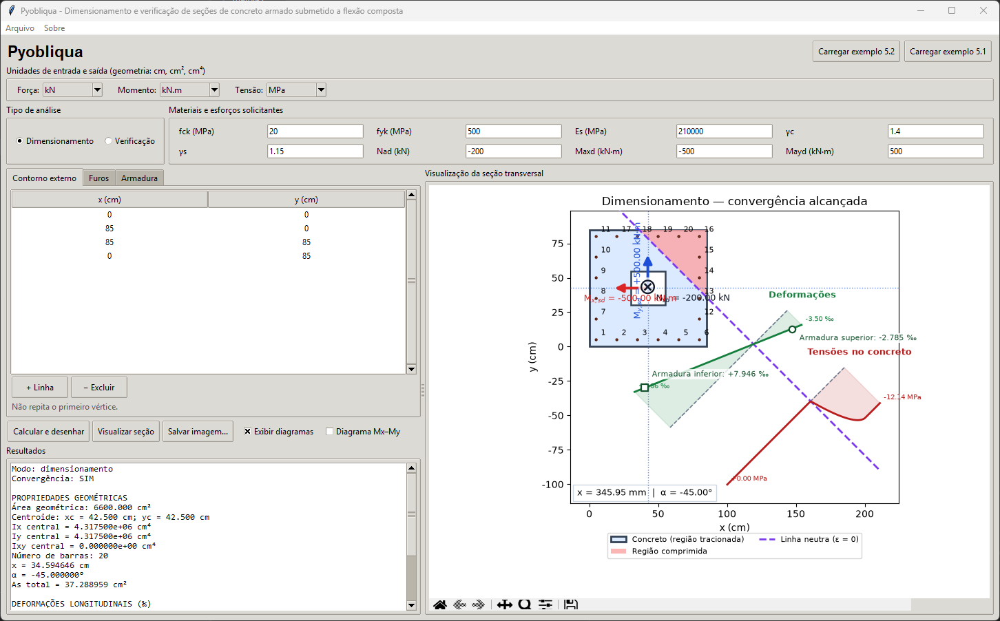

# Pyobliqua

**Dimensionamento e verificação de seções de concreto armado submetidas à flexão composta oblíqua.**

O **Pyobliqua** é um programa desenvolvido em Python para fins acadêmicos. Pode ser utilizado por meio de uma **interface gráfica** ou diretamente em **scripts Python**.

## 1. Funcionalidades

- Dimensionamento da armadura de seções poligonais de concreto armado.
- Verificação de seções com armadura conhecida.
- Representação de seções poligonais, incluindo furos e barras de aço.
- Visualização da seção transversal, linha neutra, deformações e tensões.
- Geração do diagrama de interação **Mx–My**.
- Leitura e gravação dos dados da interface em arquivos `.dad`.

O projeto conta também com uma [**Apresentação em pdf**](https://github.com/felquevedo/Pyobliqua/blob/main/docs/apresentacao/pyobliqua_metodologia_2014_marp.pdf), destinada à explicação da metodologia de cálculo e à demonstração do programa.

## 2. Instalação no Windows

Baixe o instalador na página de versões do projeto:

[**Baixar Pyobliqua para Windows**](https://github.com/felquevedo/Pyobliqua/releases/latest)

Execute o instalador e siga as instruções. Não é necessário instalar Python.

## 3. Abrir a interface gráfica usando o Python

Com o projeto configurado no ambiente Python, execute na raiz do repositório:

```powershell
python -m pyobliqua
```

A interface permite informar a geometria, as propriedades dos materiais e os esforços solicitantes, realizar os cálculos e visualizar os resultados.



## 4. Utilizar em scripts Python

O arquivo **`main.py`** contém exemplos de **dimensionamento** (Exemplo 5.1) e **verificação** (Exemplo 5.2). Ele pode ser usado como ponto de partida para criar outros estudos e automatizar cálculos.

**[Consultar ou baixar o arquivo main.py](src/pyobliqua/main.py)** — no GitHub, abra o link e utilize **Download raw file** para salvá-lo.

Para executar os exemplos:

```powershell
python -m pyobliqua.main
```

Também é possível utilizar a API do pacote em scripts próprios:

```python
from pyobliqua import Modelo, Unidades

modelo = Modelo(Unidades(forca="kN", momento="kN.m", tensao="MPa"))

# Defina a seção e os materiais como nos exemplos do main.py.
# resultado = modelo.dimensionar(secao, concreto, aco, Nsd, Msdx, Msdy)
# resultado = modelo.verificar(secao, concreto, aco, As=As, Nsd=Nsd, Msdx=Msdx, Msdy=Msdy)
```

## 5. Estrutura principal do repositório

```text
Pyobliqua/
├── README.md
├── pyproject.toml
├── docs/
│   └── apresentacao/          # Apresentação em Marp
├── examples/                  # Exemplos complementares
├── scripts/                   # Scripts auxiliares
├── src/
│   └── pyobliqua/
│       ├── __main__.py        # Inicialização da interface gráfica
│       ├── main.py            # Exemplos de uso em scripts
│       ├── api.py             # API do programa
│       ├── analise/
│       ├── materiais/
│       ├── secao/
│       ├── interface/
│       └── visualizacao/
└── tests/                     # Testes automatizados
```

O projeto conta também com uma **apresentação em Marp**, destinada à explicação da metodologia de cálculo e à demonstração do programa.

## 6. Referências e Escopo

CAMPOS FILHO, Américo. *Dimensionamento e verificação de seções poligonais de concreto armado submetidas à flexão composta oblíqua*. UFRGS, 2014. Capítulos 1–5 e Anexo A.

ASSOCIAÇÃO BRASILEIRA DE NORMAS TÉCNICAS. *ABNT NBR 6118:2014: Projeto de estruturas de concreto*.

MVREAL. FCO. GitHub, [s. d.]. Disponível em: https://github.com/mvreal/FCO. Acesso em: 14 out. 2026.

> O conteúdo normativo desta apresentação segue a referência de 2014. O programa é apresentado como ferramenta acadêmica em desenvolvimento, com validação numérica independente pendente.

## 7. Autoria e licença

**Felipe Quevedo** — desenvolvimento do Pyobliqua.

O programa destina-se ao **ensino e à pesquisa**. Seus resultados devem ser verificados independentemente e não substituem as normas técnicas aplicáveis. Consulte o arquivo [LICENSE](LICENSE) para as condições de uso.