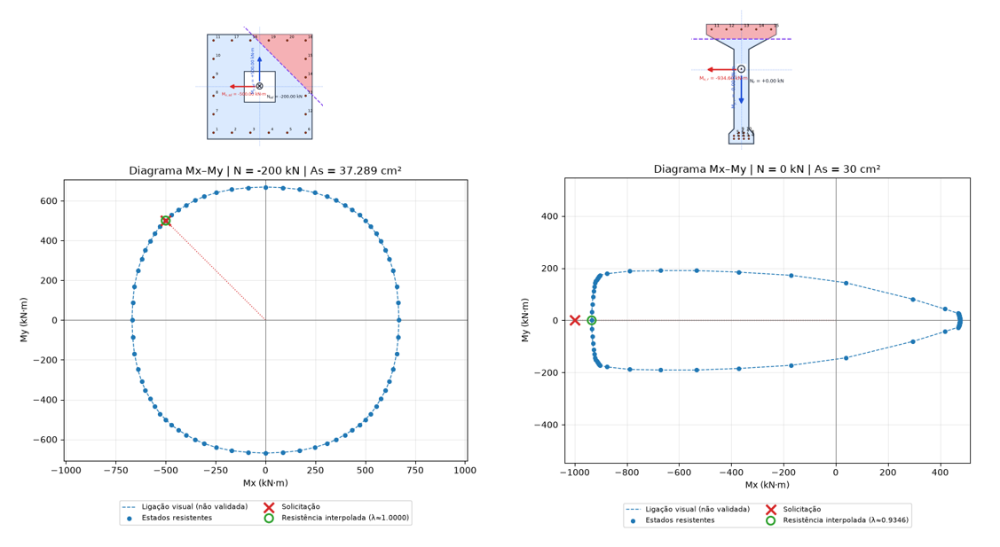
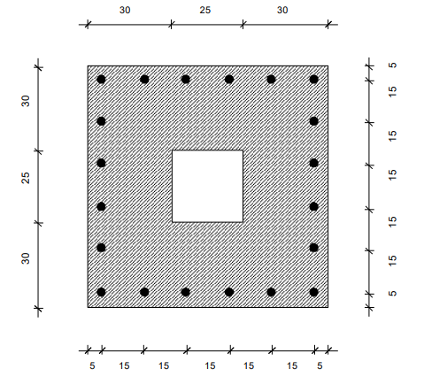
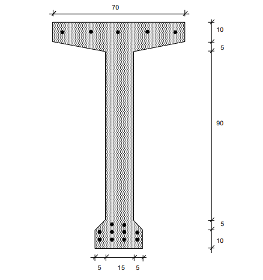

<!-- _class: lead -->

# Flexão composta Oblíqua no Estado Limite Último

## Dimensionamento e verificação de seções poligonais

### Apresentação do programa: Pyobliqua

Metodologia de Américo Campos Filho (2014) e implementação atual em Python  
UFRGS | Engenharia Civil

---

## Objetivos

Ao final dessa aula você deve conseguir:

- identificar o que é a flexão composta
- explicar como $x$ e $\alpha$ definem o campo de deformações;
- relacionar deformações, tensões e esforços resistentes;
- distinguir dimensionamento de verificação;
- reconhecer o papel do `least_squares` no Pyobliqua;
- interpretar resultados sem confundir convergência com validação.

---

## Flexão composta oblíqua

Na flexão composta atuam simultaneamente força normal e momentos fletores.

$$
\mathbf S_d = (N_{sd},M_{sdx},M_{sdy})
$$

A flexão é **oblíqua** quando a orientação da linha neutra não é conhecida a priori.

A análise precisa encontrar a profundidade $x$ e a inclinação $\alpha$ compatíveis com o equilíbrio.

---

## Sequência do cálculo

O processo de cálculo (dimensionamento ou verificação) de seções submetidas à flexão composta oblíqua, segue o seguinte roteiro de cálculo:

$$
\textbf{geometria} \longrightarrow \textbf{deformações} \longrightarrow
\textbf{tensões} \longrightarrow \textbf{esforços resistentes}
\longrightarrow \textbf{equilíbrio}
$$

> Cada etapa usa a saída da anterior. O solver atua no final, ajustando as incógnitas do problema para reduzir o desequilíbrio entre solicitações de cálculo e resistências de cálculo.

---

## Geometria poligonal

Para se ter generalidade, a seção de concreto armado é representada por uma poligonal fechada:

- o contorno externo é orientado no sentido anti-horário;
- os contornos dos furos são orientados no sentido horário;
- cada barra tem sua posição, sua área $A_s$ em caso de o dimensionamento, ou uma fração da área total $\rho$ em caso de verificação.

Essa representação é adequada para a técnica de integração de Green que permite calcular os esforços resistentetes do concreto transformando integral de área em integrais de contorno.

---

## Sistema global e Sistema centroidal

As coordenadas geométricas definem a seção no sistema global $(X,Y)$. Calculam-se área e centroide e transfere-se a origem do sistema para o centroide da seção:

$$
x=X-X_C, \qquad y=Y-Y_C
$$

Os esforços resistentes $N_{R}$, $M_{Rx}$, $M_{Ry}$ são então referidos aos eixos centroidais locais e comprados com as solicitações atuantes de cálculo $N_{Ad}$, $M_{Axd}$ e $M_{Ayd}$.

---

## Hipótese de deformações planas e sistema local $(\xi,\eta)$

Adota-se que as **seções planas permanecem planas**, ou seja, a deformação longitudinal varia linearmente ao longo da seção.

O **estado de deformações** passa a ser definido pela **profundidade** $x$ da linha neutra e pela **orientação** $\alpha$, de modo que para cada ponto $(x,y)$, correspondem ao par $(\xi,\eta)$ no sistema local, dado por:

$$
\xi=x\cos\alpha+y\sin\alpha
$$

$$
\eta=-x\sin\alpha+y\cos\alpha
$$

---

O campo de deformações passa a ser:

$$
\varepsilon(\eta)=b\eta+c
$$

E dessa forma a deformação de qualquer ponto $P$ é obtida por sua coordenada local:

$$
\varepsilon_P=b\eta_P+c
$$

A linha neutra corresponde ao conjunto de pontos em que $\varepsilon=0$.

---

## Domínios de deformação no ELU

Os domínios representam configurações-limite de deformação da seção:

---

| Domínio | Situação física predominante |
|---|---|
| reta a | Tração uniforme, ruptura por deformação plástica excessiva da armadura |
| 1 | Tração não uniforme, sem compressão, ruptura por deformação plástica excessiva da armadura inferior |
| 2 | Flexão simples ou composta sem ruptura à compressão do concreto com o máximo alongamento permitido da armadura |
| 3 | Flexão simples ou composta sem ruptura com ruptura do concreto e escoamento da armadura |
| 4 | Flexão simples ou composta com ruptura à compressão do concreto e aço sem escoamento |
| 4a | Flexão composta com armaduras comprimidas |
| 5 | Compressão não uniforme, sem tração |
| reta b | Compressão uniforme |

---

Os limites de $x$, $\varepsilon_s$ e $\varepsilon_i$ dependem de $d$, $h$, $\varepsilon_{c2}$ (deformação do ínicio do patamar plástico do concreto) e $\varepsilon_{cu}$ (deformação última do concreto, associado à ruptura). A Tabela 1 abaixo mostra os limites de cada domínio de deformação:

---

Dessa forma, para cada orientação $\alpha$, a geometria fornece as coordenadas $\eta$ das fibras extremas e a altura útil $d$ da armadura. A Tabela 1 relaciona $x$ às deformações-limite em cada domínio.

**Exemplo nos domínios 3–4**, com compressão negativa:

$$
\varepsilon_s=-\varepsilon_{cu}
$$

$$
\varepsilon_i=\varepsilon_{cu}\frac{d-x}{x}
$$

---

Conhecidas as deformações nos pontos extremos $(\eta_s,\varepsilon_s)$ e $(\eta_i,\varepsilon_i)$, tem-se:

$$
b=\frac{\varepsilon_s-\varepsilon_i}{\eta_s-\eta_i}, \qquad
c=\varepsilon_s-b\eta_s
$$

Logo, para qualquer ponto $P$, inclusive uma barra:

$$
\varepsilon_P=b\eta_P+c
$$

Essa etapa é a compatibilidade cinemática que conecta a posição da linha neutra à deformação em qualquer ponto da seção.

---

## Lei Constitutiva do Concreto

Nessa formulação, a resistência à tração do concreto é desprezada. Adota-se o sentido da compressão negativa e a lei parábola-retângulo. A expressão usa os limites $\varepsilon_{c2}$ e $\varepsilon_{cu}$ e os coeficientes $a_1$ e $a_2$ de modo que:

$$
\sigma_c(\varepsilon)=
\begin{cases}
0, & \varepsilon\geq 0 \\
\sigma_{cd}(a_2\varepsilon^2+a_1\varepsilon), & -\varepsilon_{c2}\leq\varepsilon<0 \\
-\sigma_{cd}, & -\varepsilon_{cu}\leq\varepsilon< -\varepsilon_{c2}
\end{cases}
$$

$$
f_{cd}=\frac{f_{ck}}{\gamma_c}, \qquad \sigma_{cd}=0{,}85f_{cd}
$$

Os coeficientes $a_1$ e $a_2$ aproximam o diagrama do concreto por uma parábola. Esse aspecto facilita a integração.

---

A Tabela abaixo mostra os coeficientes que aproximam o trecho parabólico.

| Classe | $a_2$ | $a_1$ |
|---:|---:|---:|
| $f_{ck}<50$ MPa | 250000 | 1000 |
| C60 | 120101 | 720,64 |
| C70 | 81458 | 620,29 |
| C80 | 69363 | 581,26 |
| C90 | 64545 | 561,34 |

$$
\sigma_c(\varepsilon)=
\begin{cases}
0, & \varepsilon\geq 0 \\
\sigma_{cd}(a_2\varepsilon^2+a_1\varepsilon), & -\varepsilon_{c2}\leq\varepsilon<0 \\
-\sigma_{cd}, & -\varepsilon_{cu}\leq\varepsilon< -\varepsilon_{c2}
\end{cases}
$$

---

São adotadas as seguintes deformações limites para **Concretos até C50**:

$$
\varepsilon_{c2}=2{,}0\,‰, \qquad \varepsilon_{cu}=3{,}5\,‰
$$

E para **Concretos entre C50 e C90** os limites de deformação variam com $f_{ck}$:

$$
\varepsilon_{c2}=2{,}0\,‰+0{,}085\,‰(f_{ck}-50)^{0{,}53}
$$

$$
\varepsilon_{cu}=2{,}6\,‰+35\,‰\left(\frac{90-f_{ck}}{100}\right)^4
$$

Importante notar que nessas fórmulas é necessário utilizar a resistência em MPa.

---

## Lei Constitutiva da Armadura

Para cada barra, calcula-se a deformação no seu ponto. E para obter as tensões, é utilizado a lei constitutiva bilinear definida por uma tensão de escoamento de cálculo, uma deformação no escoamento e deformação última. 

Cada barra contribui com tensão e área. No dimensionamento, busca-se a fração da área total $A_s$ referente a barra.

$$
f_{yd}=\frac{f_{yk}}{\gamma_s}, \qquad
\varepsilon_{yd}=\frac{f_{yd}}{E_s}
$$

$$
\sigma_s(\varepsilon)=
\begin{cases}
E_s\varepsilon, & |\varepsilon|<\varepsilon_{yd} \\
\operatorname{sgn}(\varepsilon)f_{yd}, & |\varepsilon|\geq\varepsilon_{yd}
\end{cases}
$$

---

## Regiões de integração das tensões do Concreto

O campo de deformações divide a seção em três regiões:

| Região | Faixa de deformação | Contribuição |
| :---: | :---: | --- |
| 0 | $\varepsilon\geq0$ | Concreto sem tensão resistente |
| I | $-\varepsilon_{c2}\leq\varepsilon<0$ | Tensão parabólica |
| II | $-\varepsilon_{cu}\leq\varepsilon< -\varepsilon_{c2}$ | Tensão constante |

Os contornos são recortados nas transições $\varepsilon=0$ e $\varepsilon=-\varepsilon_{c2}$. Isso permite integrar cada lei na sua correspondente região.

---

## Integração pelo Teorema de Green

As integrais de área são convertidas em integrais de contorno. Cada aresta do polígono é uma reta, o que facilita a integração podendo ser calculada analíticamente.

As contribuições do contorno externo e dos furos são somadas com sinais definidos pela orientação dos vértices. A formulação parte da segunte expressão:
$$
\iint_A \xi^p\eta^q\,dA
=\oint_{\partial A}\frac{\xi^{p+1}\eta^q}{p+1}\,d\eta
$$

---

## Integrais exigidas pela lei parabólica

Substituindo $\varepsilon=b\eta+c$ na expressão da tensão parabólica, resulta um polinômio em $\eta$, dado por:

$$
\sigma_c=\sigma_{cd}(D_0+D_1\eta+D_2\eta^2)
$$

$$
D_0=a_1c+a_2c^2, \quad
D_1=a_1b+2a_2bc, \quad D_2=a_2b^2
$$

Os esforços do concreto exigem integrais de monômios até ordens suficientes para integrar $\sigma_c$, $\sigma_c\eta$ e $\sigma_c\xi$. O esquema de integração calcula essas parcelas ao longo dos segmentos recortados.

---

## Resultantes resistentes

No sistema rotacionado $(\xi,\eta)$, integram-se tensões sobre o concreto e somam-se as contribuições discretas das barras. O sinal do momento depende da convenção dos eixos e dos esforços definida para a seção. 

As barras entram como parcelas discretas. Para cada barra $j$, o cálculo usa posição, deformação, tensão e área $A_{sj}$.

$$
N_R=\int_{A_c}\sigma_c\,dA+\sum_j A_{sj}\sigma_{sj}
$$

$$
M_{R\xi}=\int_{A_c}\sigma_c\eta\,dA+\sum_j A_{sj}\sigma_{sj}\eta_j
$$

$$
M_{R\eta}=-\int_{A_c}\sigma_c\xi\,dA-\sum_j A_{sj}\sigma_{sj}\xi_j
$$

---

## Transformação dos momentos

Como explicado anteriormente, os momentos resistentes são transformados para os eixos centrais $(x,y)$ antes da comparação com $M_{sdx}$ e $M_{sdy}$. Essa transformação é feita através da seguinte expressão:

$$
M_{Rx}=M_{R\xi}\cos\alpha-M_{R\eta}\sin\alpha
$$
$$
M_{Ry}=M_{R\xi}\sin\alpha+M_{R\eta}\cos\alpha
$$

Veja que a força normal, por ser perpendicular, não depende da rotação dos eixos. Essa transformação é importante pois mantém os momentos resistentes no mesmo referencial dos momentos atuantes.

---

## Condição de equilíbrio

O estado resistente deve satisfazer simultaneamente o equilíbrio da força normal e dos dois momentos fletores, ou seja:

$$
N_R=N_{sd}, \qquad M_{Rx}=M_{sdx}, \qquad M_{Ry}=M_{sdy}
$$

Definindo $\mathbf r=\mathbf R-\mathbf S_d$:

$$
\mathbf r=\begin{bmatrix}
N_R(x,\alpha,A_s)-N_{sd} \\
M_{Rx}(x,\alpha,A_s)-M_{sdx} \\
M_{Ry}(x,\alpha,A_s)-M_{sdy}
\end{bmatrix}=\mathbf 0
$$

---

## Dimensionamento - busca das incógnitas $x,\alpha,A_s$

Conhecidas a geometria, as posições das barras e suas proporções, procura-se a área total de aço. Cada tentativa define deformações, tensões e solicitações resultantes. O resultado deve respeitar equilíbrio, admissibilidade das variáveis e coerência das entradas.

$$
\mathbf u_d=(x,\alpha,A_s)
$$

O dimensionamento ajusta essas três incógnitas para atender às três equações de equilíbrio.

---

## Verificação - busca das incógnitas $x,\alpha,\lambda$

Com $A_s$ conhecida, a verificação procura o estado resistente e o fator de reserva $\lambda$. Força normal e momentos resistentes ficam proporcionais às solicitações. De modo que:

$$
\mathbf R(x,\alpha,A_s)=\lambda\mathbf S_d
$$

$$
\mathbf u_v=(x,\alpha,\lambda)
$$

O programa resolve três equações para $x$, $\alpha$ e $\lambda$.

---

Na verificação, para uma solução válida do equilíbrio proporcional tem-se:

| Resultado | Interpretação radial |
| :---: | --- |
| $\lambda<1$ | A resistência calculada é inferior à solicitação aplicada |
| $\lambda=1$ | Resistência e solicitação coincidem |
| $\lambda>1$ | A resistência calculada excede a solicitação ao longo do raio adotado |

Essa leitura depende da solução, das convenções de sinal e da hipótese de proporcionalidade. $\lambda$ não substitui verificações normativas ou a análise completa do elemento estrutural.

---

## Método numérico para buscar a solução das incógnitas

**Campos Filho (2014)**

A apostila desenvolve o método de Newton–Raphson, que usa a Jacobiana para atualizar a estimativa das incógnitas.

**Pyobliqua**

O programa usa `scipy.optimize.least_squares` para minimizar a função objetivo formada pelo resíduo do equilíbrio (norma euclidiana ao quadrado):

$$
\min_{\mathbf u}\;\frac{1}{2}\lVert\widetilde{\mathbf r}(\mathbf u)\rVert_2^2
$$

> Importante: a parada do otimizador, por si só, não garante resíduos suficientemente pequenos.

---

As três equações têm unidades e magnitudes diferentes. O programa normaliza os resíduos de força e momentos antes da minimização.

$$
\widetilde r_i=\frac{R_i-S_i}{s_i}
$$

Limites para as incógnitas e estimativas iniciais ajudam a manter a busca em uma faixa numérica definida.

> Importante: conferir `success` e mensagem do solver, norma dos resíduos e tolerância de equilíbrio, além da plausibilidade de $x$, $\alpha$, $A_s$ ou $\lambda$.

---

## Resumo

| Campos Filho (2014) | Pyobliqua |
|---|---|
| Linearização local do sistema não linear | Minimização da norma dos resíduos |
| Atualização usando a matriz Jacobiana | Jacobiana estimada pelo algoritmo do SciPy, salvo configuração diferente |
| Procura satisfazer diretamente $\mathbf r=0$ | Procura reduzir $\lVert\widetilde{\mathbf r}\rVert$ |
| Convergência depende da estimativa e da regularidade local | Convergência também depende da estimativa, escalas, limites e tolerâncias |

A formulação mecânica é preservada. Muda o procedimento numérico usado para encontrar as incógnitas.

---

## Fluxo computacional do Pyobliqua

1. Ler geometria, barras, materiais e solicitações.
2. Formar o estado de deformação para $(x,\alpha)$.
3. Calcular tensões do concreto e do aço.
4. Integrar as parcelas e transformar os esforços.
5. Avaliar os resíduos normalizados.
6. Atualizar incógnitas até a parada do solver.
7. Verificar equilíbrio e apresentar resultado e visualização.

As etapas de 2 a 6 são repetidas para cada tentativa do solver.

---

## Organização funcional do programa

| Camada | Responsabilidade |
|---|---|
| Geometria | Polígonos, furos, propriedades e barras |
| Materiais | Leis constitutivas do concreto e do aço |
| Análise | Deformações, integração, esforços, equilíbrio e verificação |
| Interação | Estados resistentes para o diagrama $M_x$–$M_y$ |
| Interface | Entradas Tkinter, resultados e visualizações Matplotlib |

A separação permite entender a cadeia de cálculo e localizar cada operação no programa.

---

## Dados e unidades na interface

A interface apresenta dimensões e propriedades geométricas em cm, cm² e cm⁴. Internamente, os módulos de análise usam mm e mm², com tensões em MPa e esforços em N e N·mm.

$$
1\,\text{cm}=10\,\text{mm}, \qquad
1\,\text{cm}^2=100\,\text{mm}^2
$$

Uma conversão incorreta afeta tanto as deformações quanto os braços de alavanca e os esforços.

---

---

## Visualização da seção e do estado resistente

A janela principal associa o resultado numérico à geometria analisada:

- contorno externo e furos;
- posição das barras;
- orientação da linha neutra;
- distribuição de deformações;
- esforços solicitantes e resistentes, quando disponíveis.

O desenho ajuda a detectar erros de entrada e a interpretar o estado de deformação. Ele não substitui a conferência numérica dos resíduos.

---

## Saída do dimensionamento

O modo dimensionamento informa a área total de aço calculada e o estado resistente associado. O programa apresenta os seguintes itens:

- geometria e propriedades da seção;
- $x$, $\alpha$ e $A_s$;
- deformações extremas e domínio;
- esforços resistentes e resíduos de equilíbrio;
- visualização da seção.

Uma mensagem de convergência deve ser lida junto da norma dos resíduos e dos dados de entrada.

---

## Saída da verificação

O modo verificação recebe $A_s$ fixa e apresenta $x$, $\alpha$ e $\lambda$. O programa apresenta os seguintes itens:

- armadura fornecida;
- resultantes para o estado calculado;
- fator de reserva;
- norma dos resíduos e estado de convergência;

---

---

## Diagrama de interação $M_x$–$M_y$

Para complementar a análise, foi adicionado o cálculo do diagrama de interação. Para $N_{sd}$ e $A_s$ fixos, o programa amostra estados resistentes em diversas orientações da linha neutra.

Na configuração atual da interface, a busca usa 72 orientações angulares e até 100 profundidades por orientação. Os pontos encontrados são mostrados no plano $(M_x,M_y)$, junto da solicitação.

O resultado é uma amostragem numérica. A interface alerta que o gráfico não é uma envoltória resistente certificada e que a posição do ponto solicitante não comprova segurança estrutural.

---

---

O programa pode estimar $\lambda$ por interpolação radial entre estados amostrados e o vetor de momentos solicitantes.

Essa estimativa depende da cobertura angular e dos estados encontrados. Se não houver pontos adequados, o programa pode não determinar $\lambda$ por interpolação.

O gráfico e a estimativa são recursos de análise e visualização. Não constituem validação independente nem verificação normativa completa.

---

## Exemplo 5.1: dimensionamento

| Dado | Valores |
| :---: | :---: |
| Geometria | Seção quadrada vazada: contorno externo de 85 × 85 cm e furo central de 25 × 25 cm; 11 vértices no arquivo de entrada. |
| Coeficientes parciais | $\gamma_c=1{,}4$; $\gamma_s=1{,}15$. |
| Concreto | $f_{ck}=20\,\text{MPa}$. |
| Aço | 20 barras; $f_{yk}=500\,\text{MPa}$; $E_s=210\,\text{GPa}$; $\rho_j=0{,}05$ por barra. |
| Solicitações | $N_{sd}=-200\,\text{kN}$; $M_{sdx}=-500\,\text{kN·m}$; $M_{sdy}=+500\,\text{kN·m}$. |
| Resultado publicado | $A_s=37{,}29\,\text{cm}^2$; deformação na fibra superior $=-3{,}500\,‰$; na inferior $=+7{,}946\,‰$; inclinação da linha neutra $\alpha=-45^\circ$. |

---

## Exemplo 5.2: verificação

| Dado | Valor |
| :---: | :---: |
| Geometria | Seção poligonal em “I”: 13 vértices; altura de 120 cm, mesa superior de 70 cm, alma de 15 cm e mesa inferior de 25 cm. |
| Coeficientes parciais | $\gamma_c=1{,}4$; $\gamma_s=1{,}15$. |
| Concreto | $f_{ck}=20\,\text{MPa}$. |
| Aço | 15 barras; área total fornecida $A_s=30\,\text{cm}^2$; $f_{yk}=500\,\text{MPa}$; $E_s=21\,000\,\text{kN/cm}^2=210\,\text{GPa}$; $\rho_j=0{,}066667$ por barra. |
| Solicitações | $N_{sd}=0$; $M_{sdx}=-1\,000\,\text{kN·m}$; $M_{sdy}=0$. |
| Resultado publicado | Reserva $=0{,}9346$; momento resistente $M_{Rx}=-93\,460\,\text{kN·cm}=-934{,}6\,\text{kN·m}$; deformação superior $=-1{,}445\,‰$; inferior $=+10{,}000\,‰$; $\alpha\approx0^\circ$. |

---

## O que a convergência informa

Convergência informa que o procedimento numérico atingiu seus critérios de parada. Para avaliar o resultado, também se observam:

- resíduos nas três equações de equilíbrio;
- tolerância usada para aceitá-los;
- domínio de deformação e limites dos materiais;
- dados e unidades da geometria, armadura e solicitações.

Um otimizador pode parar sem que o equilíbrio esteja atendido. O Pyobliqua separa o estado do SciPy da aceitação baseada nos resíduos.

---

## Estado da validação

**A validação numérica independente ainda não foi realizada.**

Portanto, esta apresentação descreve brevemente a formulação, a implementação e o comportamento observado do programa. Não declara o Pyobliqua integralmente validado nem recomenda usar seus resultados sem as verificações técnicas pertinentes.

Próxima etapa de validação: comparar casos selecionados com cálculos independentes, referências publicadas ou soluções de outro procedimento, documentando tolerâncias e diferenças.

---

## Referências e escopo

CAMPOS FILHO, Américo. *Dimensionamento e verificação de seções poligonais de concreto armado submetidas à flexão composta oblíqua*. UFRGS, 2014. Capítulos 1–5 e Anexo A.

ASSOCIAÇÃO BRASILEIRA DE NORMAS TÉCNICAS. *ABNT NBR 6118:2014: Projeto de estruturas de concreto*.

O conteúdo normativo desta apresentação segue a referência de 2014. O programa é apresentado como ferramenta acadêmica em desenvolvimento, com validação numérica independente pendente.
